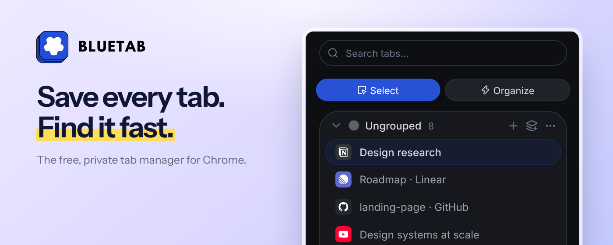
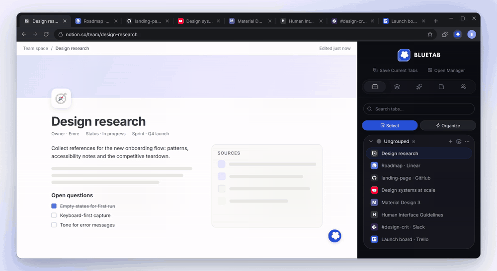
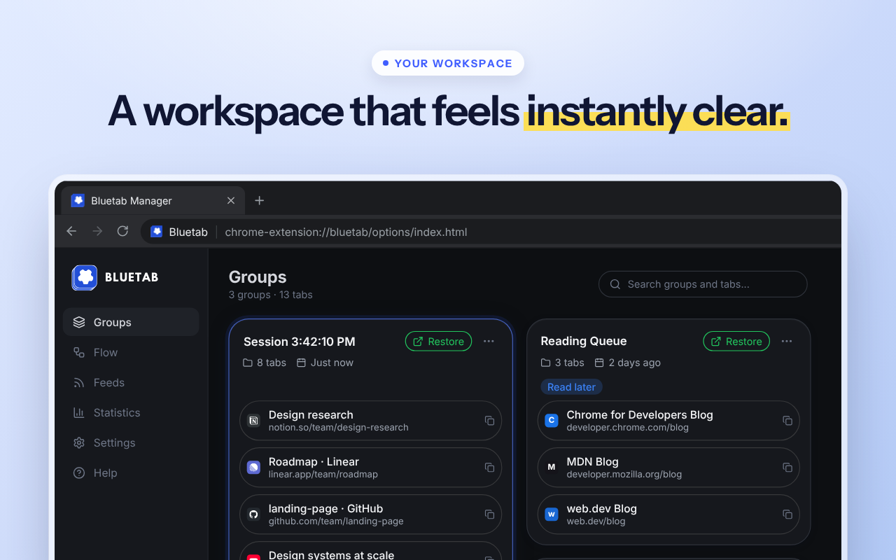
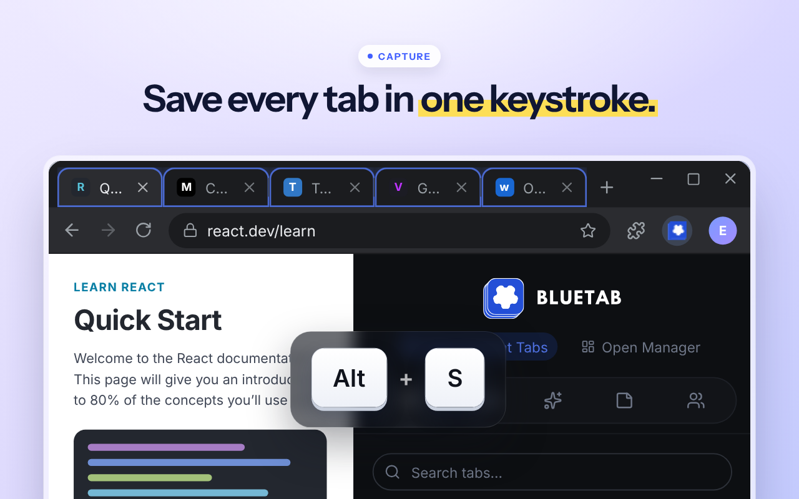
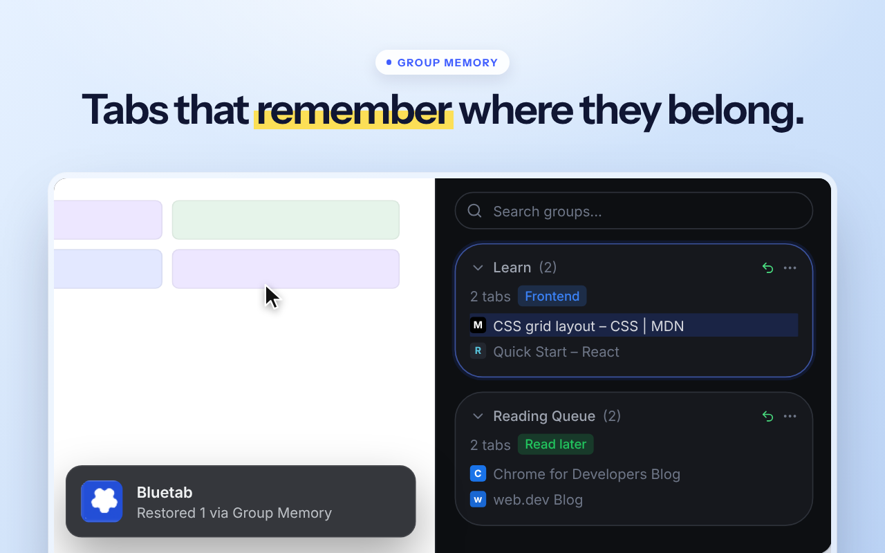
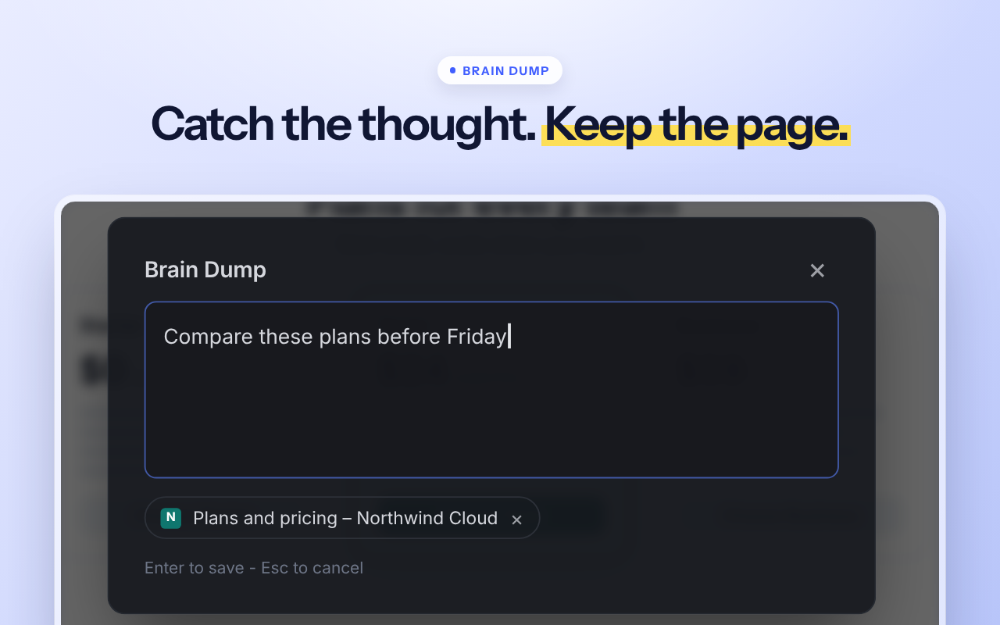
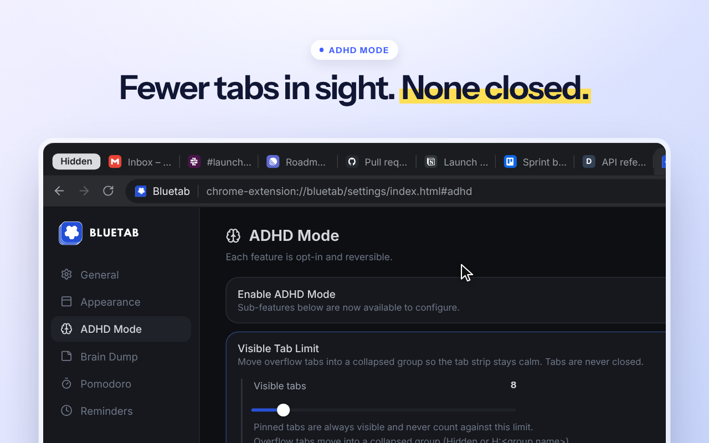

<div align="center">


# Bluetab

### Save every tab. Find it fast. Keep fewer in sight, none closed.

A calm, private tab manager for Chrome and Firefox.<br/>
The free plan runs on your device. No account needed.

[](https://chromewebstore.google.com/detail/hddffdgifegmcilhcnamabcamdbpogdb)
[](https://addons.mozilla.org/firefox/addon/bluetab/)
[](https://github.com/supertrydev/bluetab/actions/workflows/ci.yml)
[](LICENSE)

[](https://mcptry.com/servers/net.supertry/bluetab)

**[Website](https://bluetab.in)** · **[Install](#install)** · **[Features](#features)** · **[Build from source](#build-from-source)** · **[Report a bug](https://github.com/supertrydev/bluetab/issues/new?template=bug.yml)**



</div>

## Why Bluetab

You opened those tabs for a reason. Bluetab keeps the reason.

- **One keystroke** saves the whole window as a group you can reopen anytime.
- **Group Memory** puts a reopened tab back in the group it came from when you save again.
- **Brain Dump** catches a thought on any page without leaving it.
- **ADHD Mode** keeps fewer tabs in sight. Extra tabs fold into collapsed tab groups; nothing is closed.

All of this is free, works offline, and sends nothing to our servers.

<div align="center">

</div>

## Install

| Browser | Get Bluetab |
|---|---|
| Chrome, Edge, Brave and other Chromium browsers | [Chrome Web Store](https://chromewebstore.google.com/detail/hddffdgifegmcilhcnamabcamdbpogdb) |
| Firefox 140 or later (desktop) | [Firefox Add-ons](https://addons.mozilla.org/firefox/addon/bluetab/) |

Safari and mobile browsers are not supported.

## Features



<table>
<tr>
<td width="50%" valign="top">
<br/>
<b>Save every tab in one keystroke</b><br/>
<kbd>Alt</kbd>+<kbd>S</kbd> saves the window as a reusable group. Right-click to save one tab, the tabs to its left or right, or a link.
</td>
<td width="50%" valign="top">
<br/>
<b>Tabs that remember where they belong</b><br/>
Open a saved tab, keep working, save again. It returns to its group with the same name, color, tags and context.
</td>
</tr>
<tr>
<td width="50%" valign="top">
<br/>
<b>Catch the thought. Keep the page.</b><br/>
<kbd>Alt</kbd>+<kbd>Q</kbd> opens a quick note with the page attached. Search it later, or turn it into a group or a reminder.
</td>
<td width="50%" valign="top">
<br/>
<b>Fewer tabs in sight. None closed.</b><br/>
Visible Tab Limit, Visual Time (a Pomodoro as a shrinking disc), Flowtime, Hard Focus, Simplify Mode and Safe Auto-Suspend.
</td>
</tr>
</table>

**And more**

- Search group names, tab titles, URLs and tags. Type `bt` in the address bar to search saved tabs.
- Projects for ongoing work, tags to connect related ideas.
- Reminders that bring a saved group back when it matters.
- Password-protected archives with AES-256 encryption.
- Import tab lists, bookmark files and browser bookmarks. Back up and restore anytime.
- Site blocking for focus sessions, RSS feeds, an optional custom new tab page.
- English, Türkçe, Español, Português (Brasil), Bahasa Indonesia and العربية (right-to-left layout).

### Keyboard shortcuts

| Shortcut | Action |
|---|---|
| <kbd>Alt</kbd>+<kbd>T</kbd> | Open Bluetab (side panel in Chrome, sidebar in Firefox) |
| <kbd>Alt</kbd>+<kbd>S</kbd> | Save all tabs |
| <kbd>Alt</kbd>+<kbd>B</kbd> | Open the manager |
| <kbd>Alt</kbd>+<kbd>Q</kbd> | Brain Dump |
| `bt` <kbd>Space</kbd> in the address bar | Search saved tabs |

Change them in `chrome://extensions/shortcuts` or in Firefox under Add-ons → ⚙ → Manage Extension Shortcuts.

## Bluetab Pro (optional)

| | Free | Pro |
|---|:---:|:---:|
| Save, groups, projects, tags, search | ✓ | ✓ |
| Group Memory, Brain Dump, ADHD Mode, focus tools | ✓ | ✓ |
| Encrypted archives, import, backup | ✓ | ✓ |
| Works without an account | ✓ | |
| End-to-end encrypted sync across devices | | ✓ |
| Share a saved group as one clean link | | ✓ |
| Flow rules that sort familiar sites into the right project | | ✓ |
| Bluetab AI: ask about saved tabs, summarize pages, act in connected apps | | ✓ |
| MCP: use your saved tabs in Claude, ChatGPT, Cursor and VS Code | | ✓ |
| Send groups and notes to the task, notes and calendar apps you connect | | ✓ |

Pro is $10/month or $99/year at [supertry.net](https://supertry.net/signup). Pro features run on Supertry's servers; this repository contains the extension.

## Privacy by design

- Free features run in your browser. No account, and no analytics or tracking code in the extension.
- Synced tabs are encrypted on your device before they are uploaded.
- AI and app connections stay off until you turn them on. On Firefox, signing in first asks for the browser's built-in data consent.
- No remote code: everything the extension runs ships in the package and is built from this repository.
- We do not sell your data. [Privacy policy](https://supertry.net/privacy)

## Build from source

Requires Node.js 22 (see `.nvmrc`) and npm 10 or later.

```sh
git clone https://github.com/supertrydev/bluetab.git
cd bluetab
npm ci
npm run build           # Chrome  → dist/
npm run build:firefox   # Firefox → dist-firefox/
```

Load your build:

- **Chrome:** `chrome://extensions` → Developer mode → **Load unpacked** → `dist/`
- **Firefox:** `about:debugging#/runtime/this-firefox` → **Load Temporary Add-on** → `dist-firefox/manifest.json`

Checks:

```sh
npm test                          # unit and contract tests (Jest)
npm run lint && npm run type-check
npm run lint:firefox              # Mozilla's add-on linter
```

Store packages: `npm run package:cws` and `npm run package:amo`. Firefox reviewers: see [BUILD-FIREFOX.md](BUILD-FIREFOX.md).

## How it's built

Manifest V3 · TypeScript · React 18 · Vite · Tailwind CSS · i18next · Jest.
One codebase for both browsers. Browser-specific code lives in `src/platform/` and is chosen at build time.

```text
src/
├── background/   service worker (Chrome) / event page (Firefox)
├── sidepanel/    side panel (Chrome) / sidebar (Firefox)
├── options/      the manager: groups, projects, feeds, help
├── settings/     settings screens
├── newtab/       optional new tab page
├── content/      Brain Dump modal, floating button
├── services/     storage, sync, AI, integrations, focus tools
├── platform/     Chrome and Firefox differences
└── i18n/         translations (store texts in _locales/)
```

## Contributing

Bug reports and ideas are welcome: [open an issue](https://github.com/supertrydev/bluetab/issues/new/choose).
Pull requests go to `dev`; `main` is the version in the stores. See [CONTRIBUTING.md](CONTRIBUTING.md).
Contributors sign a one-time CLA. The CLA Assistant asks on your first pull request.

## Security

Please do not open a public issue for security problems. Email **support@supertry.net** or use GitHub's private vulnerability reporting. See [SECURITY.md](SECURITY.md).

## License

Bluetab is free software under the [GNU AGPL v3.0](LICENSE).
Notification sounds are from Pixabay under the Pixabay Content License ([NOTICE](NOTICE)).
"Bluetab" and the Bluetab logo are trademarks of Supertry LLC; forks must use their own name and logo ([TRADEMARKS.md](TRADEMARKS.md)).

<div align="center">
<sub>Made by <a href="https://supertry.net">Supertry</a> · <a href="https://bluetab.in">bluetab.in</a> · <a href="https://x.com/bluetabapp">@bluetabapp</a></sub>
</div>
